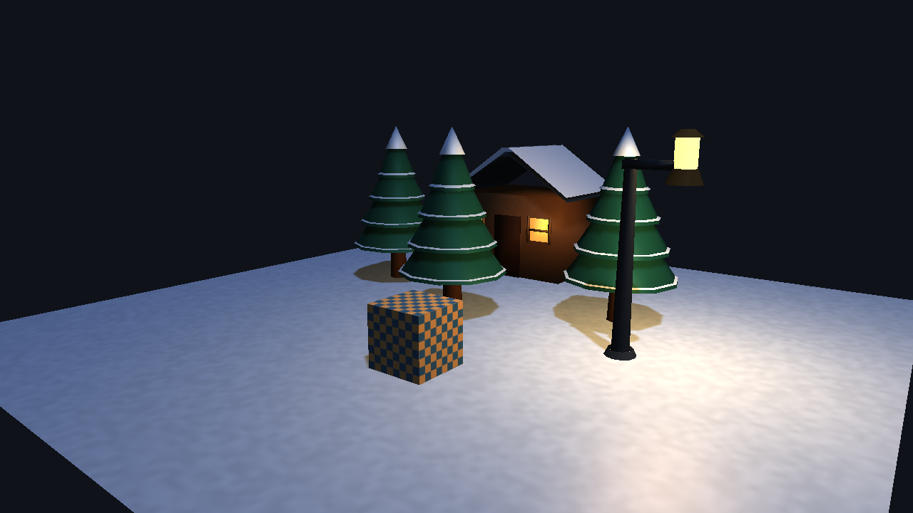

# OpenGL Scene Editor

Interactive OpenGL scene editor coursework project. See `specs/001-agent-3d-scene/` for the specification and implementation plan. The graphics editor, scene persistence, and Agent scene-operation workflow are implemented.

## Requirements

- Windows 10/11 and GPU driver with OpenGL 3.3 Core support
- CMake 3.24+, C++17 toolchain (Visual Studio 2022 with Desktop development with C++ recommended)
- Network access on first configure when dependency fetching is enabled

## Configure and build

```powershell
cmake -S . -B build -G "Visual Studio 17 2022" -A x64 -DSCENE_EDITOR_FETCH_DEPS=ON
cmake --build build --config Release --target scene_editor --parallel 4
```

Run `build/Release/scene_editor.exe` with Visual Studio generators or `build/scene_editor.exe` with single-configuration generators. Build from CLion by opening this directory as a CMake project, selecting a Visual Studio or MinGW toolchain, reloading CMake, then running the `scene_editor` target. CLion's bundled CMake can be used if `cmake` is not on `PATH`. The first configure downloads dependencies; if your network requires an HTTP proxy, configure Git's proxy before reloading CMake. Run `ctest --test-dir build -C Release --output-on-failure` after building the test targets.

For the existing Visual Studio build in this repository, double-click `run-editor.cmd` in the project root. It starts the built editor from the correct directory and keeps startup error output visible. The DeepSeek key belongs in the ignored `.env` file; see `docs/agent-setup.md`.

The editor starts with a ground plane, cube, point light, and directional light. The top toolbar adds primitives, imports OBJ files, and offers detailed snow-pine, street-lamp, and snow-cabin prefabs. The left panel lists objects and toggles visibility. The center is the 3D viewport. The right panel has Properties, Lighting, and Agent tabs. Click the viewport, hold the right mouse button to look around, use W/A/S/D to move, and Q/E to move vertically. Changes appear immediately in the viewport; status and import errors appear at the bottom. The graphics acceptance steps are in `docs/graphics-acceptance.md`.

### 界面快速上手

1. 点击顶部“立方体”“球体”或“平面”，新对象会出现在 3D 视口中并自动选中。
2. 在左侧“场景对象”中切换选中对象；右侧“属性”可修改位置、旋转、缩放、颜色和纹理。
3. 点击顶部“预设模型”可添加积雪松树、暖光路灯或雪地木屋；“导入 OBJ”可填写自己的模型路径。
4. 在右侧“灯光”中添加、调整、启用或删除点光源与平行光，并控制平行光阴影与深度偏移。
5. 点击视口后，右键拖动观察，W/A/S/D 移动，Q/E 升降；点击“重置相机”返回初始视角。
6. 点击顶部“场景文件”，选择保存文件夹、填写场景名称，然后保存；打开时使用系统文件选择器。移动场景时，请把生成的场景文件和同名 `.resources` 目录一起移动；格式与验收方法见 `docs/scene-format.md`。
7. 打开右侧“Agent”页，可用自然语言生成多步场景修改；模型配置和无需密钥的 JSON 计划验收见 `docs/agent-setup.md`。

The direct graphics editor remains the primary deliverable. Agent features call the same validated scene operations and are optional for direct rendering and editing.

## Course demonstration

1. Launch the editor and use **场景文件 → 打开** to load `assets/examples/course-demo/course-demo.json`. The scene has three detailed snow-pine OBJ models, a snow cabin, a multi-material street lamp with emissive glass and a warm point light, a grain-textured snow ground, a cool directional light with shadows, and a textured OBJ crate. Its matching `course-demo.resources/` folder contains copied OBJ, MTL, and PNG files. The model provenance is documented in `assets/prefabs/LICENSE.md` and `assets/examples/course-demo/LICENSE.md`. A rendered preview is in `docs/course-demo-preview.png`.
2. Select the crate and adjust position/scale or material. Add a cube, sphere, and plane with the toolbar; use the camera and lighting panel to show direct editing.
3. Save to a chosen folder, move the JSON and sibling `.resources` directory together, then reopen. See `docs/scene-format.md` for the file contract.
4. Fill the ignored `.env` with a DeepSeek key and try the Agent request in `docs/agent-setup.md`. Direct editing works without the key.



## Supported scope and limits

- Windows 10/11 with an OpenGL 3.3 Core GPU driver. Verified development machine and 100-object result are recorded in `docs/performance-results.md`.
- Cubes, spheres, planes, and static OBJ geometry with normals, UV coordinates, referenced MTL material, and one `map_Kd` diffuse texture per material. Animation, PBR materials, unsupported MTL texture directives, and arbitrary mesh formats are outside the course baseline.
- Blinn-Phong ambient/diffuse/specular lighting and emissive materials, up to four point lights and two directional lights. The first enabled directional light casts a 2048×2048 shadow map; the Lighting panel controls the effect, bias, and PCF radius. See `docs/phase7-graphics.md`.
- Versioned JSON scene plus sibling resource directory; a missing or invalid dependency rejects the load before replacing the current scene. See `docs/scene-format.md`.
- The optional Agent uses DeepSeek for structured scene plans. It executes only allowlisted operations; network or key errors do not prevent direct OpenGL editing. Conversation history is session-only.

## Dependency licenses and evidence

GLFW (zlib/libpng), GLAD (MIT), GLM (MIT), Assimp (BSD-3-Clause), Dear ImGui (MIT), nlohmann/json (MIT), and stb_image (MIT or public domain) are fetched at pinned versions; see `DEPENDENCIES.md` for the versions and upstream sources. OpenGL is supplied by the GPU driver. The original model permissions are in `assets/examples/course-demo/LICENSE.md` and `assets/prefabs/LICENSE.md`.

The Phase 6 quickstart results are in `docs/acceptance-results.md`; the Phase 7 graphics checks and preview comparison are in `docs/phase7-acceptance.md`. The implemented extension and limits are in `docs/phase7-graphics.md`.
